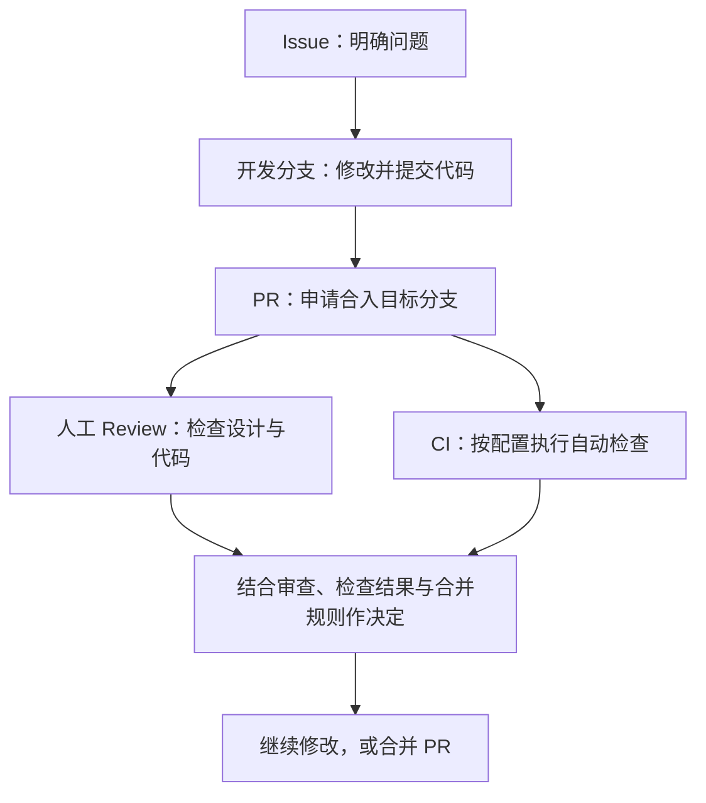
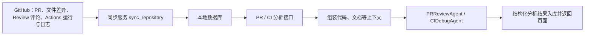

# PR 与 CI 扫盲：从基本概念到 DevFlow-AI 源码

适合读者：刚接触 GitHub 协作，希望看懂本项目 PR Review、CI Debug 和相关 Agent 的开发者。

核对日期：2026-11-02。项目行为以当前工作区源码为依据；文中的情景、示意代码和示意日志会单独标明。本文做了源码核对，没有执行真实 GitHub、模型和部署环境的端到端验证。

先记住三个问题：

- **Issue**：要解决什么问题？
- **PR（Pull Request，拉取请求）**：这批代码改动要不要合进目标分支？
- **CI（Continuous Integration，持续集成）**：配置好的自动检查执行后，有没有发现问题？

DevFlow-AI 读取这些协作材料，帮助整理审查发现和排查步骤。这里的 **Agent** 指负责特定分析任务的程序模块，会结合规则与模型生成结果。PR Review Agent 关注改动风险，CI Debug Agent 关注运行失败的证据。

阅读路线：先看第 1—4 节建立概念，再看第 5—8 节对照项目；第 9 节用于查问题，第 10—11 节用于整理面试表达和阅读源码。

## 1. 从一个开发场景开始

假设团队发现：“普通用户访问某个接口时，权限检查有问题。”下面是教学情景，不代表本项目发生过这次故障。

1. 创建 Issue，说明实际行为、预期行为和复现方法。
2. 开发者新建分支，在分支上修复代码并补充测试。
3. 把提交推送到 GitHub，创建 PR，申请合入 `main`。
4. 如果仓库配置了相应触发条件，GitHub Actions 运行检查。
5. 审查者阅读改动，提出问题；开发者继续修改并推送提交。
6. 确认审查意见、自动检查和仓库合并要求后，合并 PR。



人工 Review 和 CI 可以同时进行。CI 能检查已经写进规则和测试的内容；审查者还需要判断需求是否合理、设计是否合适，以及测试是否遗漏关键场景。

## 2. PR 到底是什么

### 2.1 先认识 branch、commit、push 和 merge

| 术语 | 中文理解 | 在这个场景里的作用 |
| --- | --- | --- |
| Repository / Repo | 代码仓库 | 保存代码和版本历史 |
| Branch | 分支 | 给一项修改提供独立的开发路径 |
| Commit | 提交 | 记录一批版本变更，带有提交标识 SHA，用来识别具体版本 |
| Push | 推送 | 把本地提交上传到远程仓库 |
| PR | 合并提案 | 把改动、说明、讨论和检查结果放在一起供审查 |
| Review | 审查 | 阅读改动并给出反馈 |
| Merge | 合并 | 把改动整合进目标分支 |

例如：

```text
head / 来源分支：fix/permission-check
base / 目标分支：main

含义：申请把 fix/permission-check 上的改动合进 main。
```

`git push` 上传提交；创建 PR 发起审查；Merge 才是执行合并。它们是不同动作。PR 也不是 `git pull` 命令。

一个 PR 可以包含多个 commit。同一个来源分支继续收到提交后，PR 会随之更新，通常不必为每次修改另开一个 PR。

### 2.2 在 GitHub 上先看什么

初学者可以先看四个位置：

| 位置 | 要看什么 |
| --- | --- |
| Conversation | 为什么改、相关讨论、审查结论 |
| Commits | 这次提案包含哪些提交 |
| Files changed | 哪些文件、哪些行发生了变化 |
| Checks | 自动检查的状态与运行详情 |

PR 是讨论和审查代码改动的载体；创建成功不代表已经合并。GitHub 的 PR 页面说明见[官方文档](https://docs.github.com/en/pull-requests/reference/pull-requests)。

### 2.3 diff、patch、changed files 怎么读

**diff** 是改动前后的差异；**patch** 是描述差异的文本；**changed files** 是发生变化的文件列表。

下面只是 diff 格式示意，不是当前源码中的真实改动：

```diff
 def can_access(user):
-    return True
+    return user.is_admin
```

- `-` 开头的行表示删除的内容。
- `+` 开头的行表示新增的内容。
- 前面只有空格的行是上下文，帮助定位改动。
- 常见的 `@@ -10,3 +10,3 @@` 表示这个差异块在旧文件和新文件中的行范围。


### 2.4 评论、批准与关闭是不同概念

PR 的普通讨论评论、针对代码位置的 Review 评论，以及整次 Review 的批准或要求修改，作用不同。普通评论与代码评论的区别可参考[GitHub 评论文档](https://docs.github.com/en/pull-requests/how-tos/review-pull-requests/commenting-on-a-pull-request)。

本项目同步的是 `/pulls/{number}/comments` 返回的 **Review 评论**，包含正文、文件路径、行号和作者。当前同步流程没有一并获取完整的批准状态或讨论解决状态。因此：

> “有 Review 评论”只能说明存在审查反馈，不能直接推出“还没处理”，也不能推出“审查已经批准”。

另外，PR 的 `closed` 状态可能表示已合并，也可能表示关闭而未合并。本项目同时保存 `state` 和 `merged_at`，判断时需要一起看。

源码：[GitHub PR 读取函数](../backend/app/services/github/pull_requests.py)、[PullRequest 与 PRReviewComment 模型](../backend/app/db/models.py)。

## 3. CI 到底在做什么

### 3.1 把检查步骤写成自动流程

开发者本地可能运行测试、检查代码规范、构建前端。CI 把这些步骤写成配置，在指定事件发生后自动执行，使每次改动都能接受相同的检查。

常见检查包括：

| 检查 | 主要回答的问题 | 例子 |
| --- | --- | --- |
| Test | 已编写用例覆盖的行为是否符合预期？ | pytest 测试 |
| Lint | 是否违反配置的静态规则？ | ESLint 检查 |
| Type check | 类型使用是否符合约束？ | TypeScript 类型检查 |
| Build | 能否完成编译、打包或产物生成？ | Next.js 构建 |
| Dependency / Security scan | 是否发现配置范围内的依赖或安全问题？ | 依赖扫描 |

CI 是一种开发实践，**GitHub Actions** 是实现自动流程的平台之一。Actions 也能做部署或自动打标签，不能把所有 Actions 运行都当成测试。

本项目读取 GitHub Actions 的 Workflow Run、Job、Step 和日志。概念依据见[Understanding GitHub Actions](https://docs.github.com/en/actions/get-started/understand-github-actions)。

### 3.2 Workflow、Run、Job、Step、Runner 的关系

```text
Workflow：一份自动化流程定义，例如 Backend CI
└── Workflow Run：这份流程的一次具体运行
    ├── Job：backend-tests
    │   ├── Step：检出代码
    │   ├── Step：安装依赖
    │   └── Step：运行 pytest
    └── Job：frontend-build
        ├── Step：检出代码
        ├── Step：安装依赖
        └── Step：运行构建

Runner：实际承载 Job 的执行环境。
```

上面是结构示意，不是本项目已有的流水线。

Workflow 好比检查方案，Run 是某次执行记录，Job 是其中一组任务，Step 是任务里的具体步骤。同一个 Job 的步骤默认依次执行；Job 之间可以通过依赖关系安排执行顺序。日志记录命令运行时的输出。

### 3.3 看一小段配置就够了

GitHub Actions 的 Workflow 通常放在仓库的 `.github/workflows/` 中，使用 YAML，即通过缩进表达结构的配置格式。

下面是**教学示例**，只用于理解结构，两个 Step 都只输出文字，没有检出项目代码、运行测试或构建。它没有被添加为本项目的 CI 配置。

```yaml
name: CI concepts demo
on: [pull_request]

jobs:
  explain:
    runs-on: ubuntu-latest
    steps:
      - name: Describe the job
        run: echo "This is one job in one workflow run"
      - name: Describe the next step
        run: echo "A real project would run its checks here"
```

`on` 声明触发事件，`jobs` 定义任务，`runs-on` 指定执行环境，`steps` 定义步骤，`run` 指定要执行的命令。真实项目需要把代码检出、语言环境、依赖和检查命令接起来。配置语法见[GitHub Workflow syntax](https://docs.github.com/en/actions/reference/workflows-and-actions/workflow-syntax)。

是否在创建 PR、推送提交或定时任务时执行，取决于事件、分支及路径过滤等配置。不能因为创建了 PR 就断言一定会运行 CI。具体触发行为见[官方事件文档](https://docs.github.com/en/actions/reference/workflows-and-actions/events-that-trigger-workflows)。

### 3.4 status 和 conclusion 不要混着看

| 字段 | 含义 | 常见值举例 |
| --- | --- | --- |
| `status` | 执行处于什么阶段 | `queued` 排队、`in_progress` 运行中、`completed` 已结束 |
| `conclusion` | 执行结果是什么 | `success` 成功、`failure` 失败、`cancelled` 取消、`skipped` 跳过 |

`status = completed` 只表示结束了，结果仍可能是失败。执行未结束时，`conclusion` 可能为空。

CI 通过只能支持“本次配置的检查通过”。还需要确认检查是否覆盖当前提交、关键行为和实际环境；没有测试到的业务问题仍可能存在。

### 3.5 CI 与 CD

CI 主要围绕持续集成和自动验证；CD 常指持续交付或持续部署，涉及把产物推进到交付、上线阶段。二者可以接在同一自动流程中，但 CI 成功不代表服务已经上线。

当前本地副本有 Docker Compose 配置，没有找到 `.github/workflows/` 文件。能确认的是具备容器启动配置和 CI 数据分析代码，不能据此声称“本项目已有自动构建、自动部署流水线”。

## 4. PR、CI 与“能不能合并”的关系

一次 PR 是否适合合并，通常要综合：

1. 改动是否实现了需求。
2. 审查发现是否已经处理。
3. 对应版本的必要检查是否完成。
4. 是否有冲突，以及是否满足仓库的合并规则。

**Merge conflict（合并冲突）**指不同分支的改动无法自动整合。**CI failure** 指某次自动检查执行失败。二者可能分别发生，也可能同时发生。

GitHub 可以通过分支保护等规则要求特定检查、审查批准或讨论解决。实际是否阻止合并，取决于仓库规则与权限，参见[分支保护文档](https://docs.github.com/en/repositories/configuring-branches-and-merges-in-your-repository/managing-protected-branches/about-protected-branches)。

DevFlow-AI 报告中的“暂缓”“阻塞合并”是分析建议。应当到 GitHub 核对对应提交的 Checks、Review 和合并规则，才能确认平台当前是否允许合并。

## 5. DevFlow-AI 的数据从哪里来

### 5.1 先同步，再分析

主链路如下：



分析按钮通常读取已同步的数据库记录。数据的新鲜程度取决于最近一次成功读取远程数据的时间；重新分析与重新同步是两个动作。

项目提供连接时同步、手动同步接口、Webhook 和可配置的定时同步。**Webhook** 指 GitHub 在指定事件发生时通知后端；本项目收到相关通知后，再安排同步任务。实际是否启用和可达需要检查环境配置。

入口：[sync_repository()](../backend/app/services/repos_sync.py)、[仓库接入与同步接口](../backend/app/api/routes/repos.py)、[Webhook 路由](../backend/app/api/routes/webhooks.py)、[定时同步循环](../backend/app/services/scheduler.py)。

### 5.2 本地存了哪些材料

| 本地模型 | 保存的主要内容 | 用途 |
| --- | --- | --- |
| `PullRequest` | 标题、描述、作者、状态、来源/目标分支、合并时间 | 理解改动目标与阶段 |
| `PRFile` | 文件路径、增删行数、patch | 阅读具体改动 |
| `PRReviewComment` | 评论正文、文件、行号、作者 | 纳入审查反馈 |
| `WorkflowRun` | GitHub run ID、名称、状态、结论、Jobs/Steps、日志 | 分析运行失败 |
| `AnalysisResult` | 分析类型、输入摘要、结构化结果等 | 保存分析记录 |

三个编号尤其容易混淆：

- PR 的 `number`：GitHub 页面上的 `#12`。
- PR 的 `id`：DevFlow 数据库中的 UUID（一种形如 `xxxxxxxx-xxxx-xxxx-xxxx-xxxxxxxxxxxx` 的唯一标识），本项目 `/pull-requests/{pr_id}` 使用它。
- Workflow Run 的 `github_run_id` 与本地 `id`：前者用于读取 GitHub，后者用于本项目 `/workflow-runs/{run_id}` 接口。

模型依据：[数据库模型](../backend/app/db/models.py)。

### 5.3 同步有覆盖边界

当前实现需要知道这些限制：

- PR 文件和 Review 评论请求设置 `per_page=100`，这层读取代码没有继续翻页；大 PR 的材料可能不完整。
- Jobs 请求同样设置 `per_page=100`；PR 和 Run 列表也受请求的 `limit` 限制。
- 只有 Run 的 `conclusion == "failure"` 时，同步服务才尝试下载日志。
- 日志 ZIP 会按文件名排序解压、拼接，最多保存 80,000 个字符；保存顺序不等于所有 Job 的全局时间顺序。
- 部分 GitHub HTTP 错误会被捕获并使用空列表或保留旧值。因此同步返回 `completed` 不能证明每个文件、评论、Job 和日志都完整。

读取实现：[GitHub PR 适配](../backend/app/services/github/pull_requests.py)、[Actions 与日志读取](../backend/app/services/github/actions.py)、[同步服务](../backend/app/services/repos_sync.py)。

## 6. 点击“生成 PR 分析”之后发生什么

### 6.1 从页面走到 Agent

```text
/pull-requests 页面：生成 PR 分析
    → POST /api/pull-requests/{pr_id}/analyze
    → 读取 PR、文件和 Review 评论
    → 默认尝试准备 PR 分支快照
    → _build_pr_analysis_context() 组装上下文
    → PRReviewAgent.run(payload, context)
    → 保存 AnalysisResult，返回 analysis_id 与 result
```

**PR 分支快照**是为检索该 PR 代码准备的独立代码副本。准备成功时会纳入快照代码和代码图线索；本地仓库模式不自动创建这种快照，失败时也可能继续使用默认 checkout 的代码。因此要核对代码证据的分支与 SHA，不能假定每条线索都对应 PR 的最新提交。

这里的 `payload` 是当前 PR 的核心数据，`context` 是额外补充的分析材料。上下文包括相关代码、项目文档、相关 Issue、Review 评论和近期 CI 汇总；提供 `conversation_id` 时还会尝试补充会话证据。代码图线索指代码中的函数、类等符号及其关系；checkout 指实际检出的代码副本。

页面与入口：[PR 页面](../frontend/app/pull-requests/page.tsx)、[analyze_pull_request() 与上下文组装](../backend/app/api/routes/pull_requests.py)、[prepare_pr_worktree()](../backend/app/services/worktree_manager.py)。

### 6.2 PRReviewAgent 真正执行什么

`run()` 的主要步骤是：

1. 用 `chunk_pr_files()` 将 patch 切块，保留文件名等信息。
2. 先构造规则兜底结果，例如敏感文件、失败 CI、大改动和测试覆盖提示。
3. 把 PR、diff 块和上下文发给模型，要求生成 JSON，即便于程序处理的结构化数据。
4. 有模型结果时，与兜底结果合并并用 Pydantic 校验字段；模型没有可用输出或结果校验失败时返回兜底结果。

当前调用是将所有 `diff_chunks` 放入一次模型请求，没有实现“每个块独立审查后再汇总”的多轮流程。Pydantic 校验的是输出结构与字段约束，不能证明审查结论正确。

源码：[PRReviewAgent.run()](../backend/app/services/agents/pr_review_agent.py)、[chunk_pr_files()](../backend/app/services/rag/chunking.py)、[PRReviewOutput](../backend/app/schemas/analysis.py)。

### 6.3 怎么读返回报告

| 字段 | 阅读重点 |
| --- | --- |
| `summary`、`key_changes` | 它是否理解了改动目的与范围？ |
| `review_findings` | 每条问题的等级、证据、必需动作和阻塞标记 |
| `blocking_issues` | 哪些事情需要先处理或核实？ |
| `merge_recommendation` | 建议合入 / 修改后合入 / 暂缓 / 拒绝 |
| `review_checklist`、`test_suggestions` | 后续要检查和验证什么？ |
| `confidence` | 程序或模型给出的参考分数；不是校准过的正确概率 |

本项目发现等级为 `P1 / P2 / P3`，可以按优先级从高到低理解：P1 优先排查或处理，P2 需要重点验证或修正，P3 通常是改进建议。当前代码没有提供完整的严重度评分标准，这里是帮助阅读的概括。

规则生成发现时默认把 P1/P2 设为阻塞；合并模型结果时还会把 P1/P2 发现收集进 `blocking_issues`，有阻塞项而建议为“建议合入”时会改为“修改后合入”。

这些处理属于应用内建议整理，不会自动设置 GitHub 的分支保护。

### 6.4 最关键的两个阅读边界

**第一，当前 PR 页面链路的 CI 汇总不是逐提交匹配。** `_build_pr_analysis_context()` 查询同仓库最近 8 次 Run，再统计其中的 `failure`，没有按 PR 的 head SHA 精确过滤。看到失败信号时，需要继续确认是哪条分支、哪次提交、是否已经被新运行替代。

**第二，评论存在不代表未解决。** 规则兜底会对已有 Review 评论提示“需要确认是否都已处理”。本地数据不足以直接证明解决状态。

这两点能解释为什么报告可能偏保守，也说明后续可以改进哪些数据关联。

## 7. 点击“分析失败原因”之后发生什么

### 7.1 从 Run、Job、Step 开始缩小范围

```text
/ci 页面：分析失败原因
    → POST /api/workflow-runs/{run_id}/analyze
    → 读取本地 WorkflowRun、Jobs、Steps 和日志
    → 提取失败 Job / Step、错误块、相关文件路径
    → 检索代码、Workflow 配置、文档和近期 PR
    → 默认尝试关联 PR 代码快照
    → CIDebugAgent.run(payload, context)
    → 保存并返回结构化诊断
```

页面依据：[CI 页面](../frontend/app/ci/page.tsx)。后端依据：[analyze_workflow_run() 与 _build_ci_analysis_context()](../backend/app/api/routes/ci.py)。

### 7.2 Agent 怎样形成排查建议

CIDebugAgent 先生成规则兜底诊断，再请求模型、合并结果并校验结构。规则会读取失败 Job/Step，匹配日志关键词，提取错误片段和文件路径。

| `failure_type` | 中文含义 | 日志信号举例 |
| --- | --- | --- |
| `test` | 测试失败 | `pytest`、`assert` |
| `build` | 构建或类型检查失败 | `next build`、`type error` |
| `lint` | 静态规则检查失败 | `eslint`、`ruff` |
| `dependency` | 安装依赖或模块解析失败 | `cannot find module` |
| `permission` | 权限问题 | `forbidden`、`eacces` |
| `environment` | 环境配置问题 | `missing env`、`not set` |
| `unknown` | 现有信息不足以分类 | 只有笼统错误信息 |

实际规则有匹配顺序：权限 → 环境 → 依赖 → lint → 构建 → 测试。日志同时出现多个关键词时，前面的类别可能先命中，因此分类是排查线索。

报告重点看 `first_error`、`root_cause`、`possible_causes`、`fix_steps`、`related_files` 和 `is_merge_blocking`。其中根因仍需通过日志、代码和复现确认。兜底阻塞规则既考虑 `failure`，也考虑已完成且分类非 `unknown` 的情况，不能把该布尔值直接当成 GitHub 的真实合并状态。

源码：[CIDebugAgent](../backend/app/services/agents/ci_debug_agent.py)。

### 7.3 用一段日志理解“症状”和“原因”

下面是示意日志，不对应当前项目的真实运行：

```text
Job: backend-tests
Step: Run pytest
E   AssertionError: expected 403, got 200
FAILED example_test_permission.py::test_normal_user_cannot_access
Process completed with exit code 1.
```

这里的 403 和 200 是 HTTP 响应状态码：403 表示拒绝访问，200 表示请求成功。最后一行只说明命令返回了失败退出码。更有用的线索是“预期 403，却得到 200”，说明权限拒绝行为与测试预期不一致。

接下来要看：测试预期是否正确、权限判断是否改变、测试用户是否配置正确，再运行相同用例复现。只根据这段输出，还不能断言某个函数就是根因。

### 7.4 当前“首个错误”和 PR 关联都是启发式

错误提取函数扫描拼接后的日志，寻找第一个包含 `error / failed / exception` 等关键词的行，再保留附近内容，最多 900 个字符。因为日志可能被截断、跨 Job 拼接，这个“首个”不是经过全局时间排序证明的首个根因。

`_related_pr_for_run()` 从近期 PR 中尝试匹配日志里的来源分支名，未命中时取最近的候选。当前 `WorkflowRun` 模型没有保存 `head_sha`、`head_branch` 等精确关联信息，匹配出的 PR 是候选线索，不能据此声称它造成了这次失败。

源码：[错误提取与 _related_pr_for_run()](../backend/app/api/routes/ci.py)。

## 8. 在当前项目里怎样实际使用

### 8.1 最短操作路径

前提是前后端和数据库已按 [README 的快速开始](../README.md)运行，仓库可访问；需要模型分析时还要有可用的模型配置。默认前端地址是 [http://localhost:3000](http://localhost:3000)，下面的页面路径都接在这个地址后面。

1. 打开[仓库接入页面](http://localhost:3000/repos) `/repos`，连接目标 GitHub 仓库并等待同步。
2. 打开 `/pull-requests`，选择 PR，点击“生成 PR 分析”。
3. 打开 `/ci`，选择 Run，查看失败 Job、Step 和日志，点击“分析失败原因”。
4. 按报告去 GitHub 核对提交、运行和 Review，完成对应复现与修复。

当前这两个独立页面都先请求 `/api/repos`，再使用返回列表的第一个仓库；不是各自提供完整的仓库选择器。CI 页面优先选中本地列表中第一个 `failure`。

页面把分析结果显示为 JSON。后端另有 `/analyze/stream` 流式接口，但这两个独立页面当前调用的是普通 `/analyze` 接口。

### 8.2 调接口时先拿本地 ID

下面的地址默认后端运行在 `http://localhost:8000`，占位符必须替换为列表接口返回的本地 UUID：

```text
GET  /api/repos
GET  /api/repos/{repo_id}/pull-requests
POST /api/pull-requests/{pr_id}/analyze

GET  /api/repos/{repo_id}/workflow-runs
GET  /api/workflow-runs/{run_id}/failed-jobs
POST /api/workflow-runs/{run_id}/analyze
```

可以通过后端 [API 文档页面](http://localhost:8000/docs)操作。同步入口为 `POST /api/repos/{repo_id}/sync`，请求体例如：

```json
{
  "sync_issues": false,
  "sync_pull_requests": true,
  "sync_workflow_runs": true,
  "limit": 30
}
```

接口返回数据后，再检查所需 PR、Jobs 和日志是否真的到位。不能只看同步状态文字。

### 8.3 自动检查命令在项目里哪里找

后端已有 pytest 测试，例如：[PR Agent 测试](../backend/app/tests/test_pr_review_agent.py)、[CI Agent 测试](../backend/app/tests/test_ci_debug_agent.py)。前端脚本在 [package.json](../frontend/package.json)。

在依赖已安装且位于项目根目录时，可以查看或尝试这些现有入口：

```bash
# 后端：这个测试文件使用替代模型，检查 PR 规则与结果修正。
cd backend
python -m pytest app/tests/test_pr_review_agent.py
```

```bash
# 另一个终端，从项目根目录进入前端目录。
cd frontend
npm run build
```

这里只说明检查入口，本次文档编写没有运行这些命令。前端还定义了 `lint` 脚本，但它与当前依赖组合的可运行性需要另行确认。测试文件和构建脚本存在，也不等于远程已经配置 CI 执行它们。

## 9. 常见疑问与排查顺序

| 现象或疑问 | 先检查什么 |
| --- | --- |
| 推送代码后为什么没出现 PR？ | Push 上传提交；还需要在 GitHub 创建合并提案 |
| PR 已创建，为什么没有 CI？ | 仓库是否有 Workflow，事件和分支/路径过滤是否匹配 |
| Run 是 `completed`，为什么还是失败？ | 看 `conclusion`；完成与成功是两个字段 |
| PR 页面没有数据 | 仓库是否接入、页面实际使用哪个仓库、PR 是否同步到本地 |
| 有 Run 却没有日志 | 是否为 `failure`、日志下载权限/可用性、同步是否遇到错误 |
| 有报告是否证明调用了模型？ | 否；模型无可用输出时 Agent 可返回规则兜底，需看实际调用记录 |
| CI 失败是否一定是代码写错？ | 还可能是依赖、权限、环境、网络或配置问题，先看失败步骤与输出 |
| 仓库近期有失败 CI，是否当前 PR 引起？ | 逐一核对分支、SHA、时间和后续运行，当前页面汇总没有精确关联 |
| 报告建议合入，是否可以直接合？ | 仍需确认对应版本的检查、审查、冲突和仓库规则 |
| 点击分析会不会自动修代码、合并或重跑 CI？ | 当前 PR/CI 分析链路没有执行这些操作 |

规则兜底相关依据：[LLMClient.chat_json()](../backend/app/services/llm/client.py)及两个专用 Agent 的 `run()`。

当前操作草稿执行器支持评论、创建/关闭 Issue、标签等动作，没有实现合并 PR、提交修复或重跑 Actions 的执行分支。PR 评论草稿走的是 PR 下的普通评论接口，也不等同于提交一条带代码行定位的正式 Review。依据：[_execute_github_draft()](../backend/app/api/routes/action_drafts.py)。

## 10. 为什么拆成 PR Agent 与 CI Agent

| 维度 | PRReviewAgent | CIDebugAgent |
| --- | --- | --- |
| 主要对象 | 一批待合入的代码改动 | 一次自动流程运行 |
| 核心输入 | 标题、描述、文件、patch、Review 评论和 CI 摘要 | Run、失败 Job/Step、日志和相关代码 |
| 主要问题 | 哪些风险需要先处理，是否建议合入？ | 失败在哪里，下一步怎样排查？ |
| 主要输出 | 分级发现、阻塞项、检查清单、合入建议 | 失败类型、错误片段、可能原因、修复步骤 |

同一个 PR 可能需要两类分析：先由 CI 诊断帮助查明测试失败，再由 PR 审查综合代码、反馈和新检查结果判断就绪程度。是否自动串联这些步骤，要看具体入口的编排实现；独立页面点击分析只调用对应 Agent。

可以用于面试的客观表达：

> PR 是团队审查并合并代码改动的协作载体，CI 是按配置自动执行检查的机制。项目通过 GitHub API 同步 PR 差异、Review 评论和 Actions 运行数据，再由 PRReviewAgent 输出风险与合入建议，由 CIDebugAgent 根据失败 Job、Step 和日志输出排查路线。两类 Agent 都结合模型输出、规则兜底和结构校验。当前 CI 与 PR 的关联仍有启发式处理，报告需要结合对应提交和 GitHub 实际规则核实。

## 11. 建议的源码阅读顺序

1. [PR 页面](../frontend/app/pull-requests/page.tsx)和 [CI 页面](../frontend/app/ci/page.tsx)：先看按钮发了什么请求。
2. [同步服务](../backend/app/services/repos_sync.py)：看 GitHub 返回数据怎样存进数据库。
3. [PR 分析路由](../backend/app/api/routes/pull_requests.py)和 [CI 分析路由](../backend/app/api/routes/ci.py)：看 payload 和 context 分别装了什么。
4. [PRReviewAgent](../backend/app/services/agents/pr_review_agent.py)和 [CIDebugAgent](../backend/app/services/agents/ci_debug_agent.py)：看规则、模型调用与结果修正。
5. [分析结果 Schema](../backend/app/schemas/analysis.py)：核对输出字段、允许值和约束。

