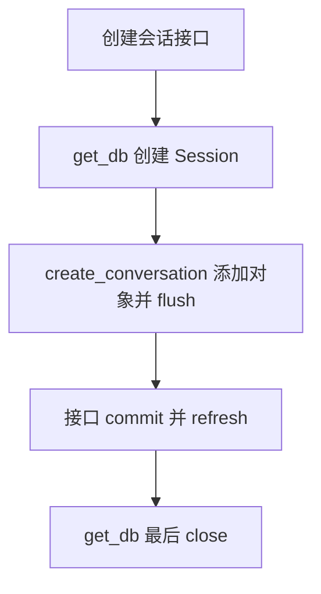

# 14 项目数据库与企业级后端面试教程

适合初学者按顺序阅读：先理解数据怎么保存，再学习并发正确性、查询性能和故障恢复。每个主题按“原理 → 项目 → 面试表达”理解。

核对日期：2026-11-10。项目结论来自当前本地源码；企业化方案均标为建议。本文未执行示例 SQL，也未验证线上性能、数据库配置或故障恢复。

## 1. 项目究竟用了哪些数据库

| 组件 | 当前作用 | 面试准备重点 |
| --- | --- | --- |
| PostgreSQL | 关系型主库，保存仓库、Issue、PR、会话、记忆、文档正文等 | 事务、MVCC、锁、索引、约束、恢复 |
| SQLAlchemy + psycopg | ORM 与数据库驱动，把 Python 对象操作转换为 SQL 并连接 PostgreSQL | Session、事务边界、连接池 |
| Milvus | 保存符合入库策略的文档向量及部分内容，支持语义召回 | 向量索引、过滤、一致性、重建 |
| pgvector | 依赖和 PostgreSQL 扩展初始化仍保留；当前向量读写走 Milvus | 能解释与 Milvus 的取舍即可 |
| Redis | Compose 中的可选服务；当前后端未发现业务调用 | 缓存和分布式锁作为扩展知识 |
| SQLite | 部分测试、演示使用 | 不能代替 PostgreSQL 专有行为验证 |

PostgreSQL 适合回答“这个 PR 属于哪个仓库、当前状态是什么”；Milvus 适合回答“有哪些资料和这个错误语义相近”。采用两套存储的代价是增加运维与数据同步成本。

依据：[部署组件](../docker-compose.yml#L1)、[依赖版本](../backend/requirements.txt#L5)、[文档模型](../backend/app/db/models.py#L192)、[扩展初始化](../scripts/init_pgvector.sql#L1)。

## 2. Session、flush、commit、rollback 分别是什么

ORM（Object-Relational Mapping，对象关系映射）让代码通过对象操作表。Engine 是管理数据库连接及 SQL 执行的入口。Session 跟踪对象变化、组织事务，需要执行 SQL 时向 Engine 借用连接；它不等于数据库，也不等于永远独占一条连接。

项目创建会话的调用链是：



| 操作 | 通俗理解 | 关键边界 |
| --- | --- | --- |
| `add()` | 登记待保存对象 | 通常还未发出 INSERT |
| `flush()` | 把待处理变更发送到数据库 | 仍在事务内，可以回滚 |
| `commit()` | 提交当前事务 | 会先 flush，即使 `autoflush=False` |
| `rollback()` | 撤销当前事务 | flush 失败后继续复用 Session 前需要调用 |
| `close()` | 清理 Session、释放连接资源 | 不会自动提交，通常把连接归还池 |

项目使用同步 `create_engine()` 和 `Session`；接口写成 `async def`，同步数据库调用也不会自动变成异步 I/O。`get_db()` 负责关闭资源，提交由业务调用方决定。

**面试口述：**“项目通过依赖注入管理 Session。服务层可以先 flush，由外层决定何时 commit；flush 只发送 SQL，不能当成持久化完成。并发任务应各自管理 Session，不能把同一个 Session 随意共享。”

依据：[Session 配置](../backend/app/db/session.py#L13)、[创建接口](../backend/app/api/routes/conversations.py#L30)、[SQLAlchemy Session 官方说明](https://docs.sqlalchemy.org/en/20/orm/session_basics.html)。

## 3. ACID：为什么多个 SQL 要放进一个事务

事务把一组数据库操作作为一个提交单元。比如删除会话，需要处理消息、记忆等关联记录；中途失败时，应避免只删一半。

| 特性 | 含义 | 在项目里怎样理解 |
| --- | --- | --- |
| Atomicity，原子性 | 同一事务整体提交或回滚 | 多表删除可以统一提交 |
| Consistency，一致性 | 保持业务与约束规定的合法状态 | 消息不能引用不存在的会话 |
| Isolation，隔离性 | 规定并发事务如何相互影响 | 两个请求同时修改会话时需要明确策略 |
| Durability，持久性 | 按持久化配置保障已提交结果 | 数据库崩溃后需要恢复提交结果 |

一致性需要正确的业务逻辑和约束共同保障。数据库不知道“一个 Issue 只能同步一次”这样的全部业务规则。

当前删除服务先删除关联数据并 flush，接口最后 commit；文档处理的异常分支则明确 rollback，再用新事务保存失败状态。整个文档处理流程包含多次提交，不能把它描述成一个大事务。

依据：[会话删除](../backend/app/services/conversations.py#L82)、[删除接口提交](../backend/app/api/routes/conversations.py#L43)、[文档失败处理](../backend/app/services/rag/document_processing.py#L140)。

## 4. MVCC 与隔离级别：为什么两次查询可能不一样

MVCC（Multi-Version Concurrency Control，多版本并发控制）通过行版本和快照决定事务能看到什么。普通快照读通常不需要等待另一个事务修改同一行，但写写冲突和 DDL（建表、改表等结构操作）的锁仍可能造成等待。

例如 A 查询 PR 状态得到 `open`，B 将它改为 `closed` 并提交，A 再次查询时：

| PostgreSQL 隔离级别 | 普通查询的表现 |
| --- | --- |
| Read Committed | 每条语句取快照，第二次可能看到 `closed`；数据库默认级别 |
| Repeatable Read | 事务内使用稳定快照；不出现不可重复读、幻读，仍可能发生序列化异常 |
| Serializable | 提交结果等价于某种串行执行；冲突时可能要求整个事务重试 |

脏读是读到别人未提交的数据；不可重复读是同一行前后值变化；幻读是同一条件的结果集合变化。PostgreSQL 的 Read Uncommitted 按 Read Committed 处理。

项目没有显式设置隔离级别；实际值需查询 `SHOW transaction_isolation`，不能把数据库默认值当成已核验的运行配置。ORM 已加载对象还可能受 Session 缓存影响，上表描述的是数据库查询语义。

更新和删除会留下待回收的旧版本。VACUUM 回收可复用空间、维护可见性等信息；长事务可能拖住清理进度。普通 VACUUM 不保证缩小磁盘文件。

依据：[MVCC](https://www.postgresql.org/docs/16/mvcc-intro.html)、[隔离级别](https://www.postgresql.org/docs/16/transaction-iso.html)、[VACUUM](https://www.postgresql.org/docs/16/routine-vacuuming.html)。

## 5. 并发正确性：锁、原子更新、唯一约束怎样分工

### 场景一：两个请求同时同步同一个仓库

项目调用 `pg_try_advisory_xact_lock()`。Advisory lock 是应用约定锁键的协作锁；同一数据库中遵守同一规则的请求才能互斥。

- 锁键来自仓库 UUID；尝试失败立即返回 `already_running`。
- 事务级锁在事务结束时释放，可以协调连接同一 PostgreSQL 的多个后端实例。
- 它不会自动锁住仓库行，也不能阻止绕过这段逻辑的写入。
- 当前获取锁后还会调用 GitHub，直到末尾提交，网络等待会延长事务和连接占用。

建议缩短持锁事务，并用任务状态、租约或版本检查处理拉取和落库的衔接；不能简单把锁提前释放，否则会重新引入并发同步。

依据：[获取同步锁](../backend/app/services/repos_sync.py#L28)、[同步入口](../backend/app/services/repos_sync.py#L44)、[最终提交](../backend/app/services/repos_sync.py#L188)、[PostgreSQL 锁](https://www.postgresql.org/docs/16/explicit-locking.html)。

### 场景二：两个请求同时把消息数加一

若双方都读到 10，再分别写 11，就可能丢失一次增量。当前 `touch_conversation()` 使用 Python 读取后赋值，存在这种并发风险；这是静态风险分析，未做并发复现。

**建议示例：**用数据库原子表达式更新计数；复杂的“先读后判断再修改”可考虑事务内 `SELECT ... FOR UPDATE`，或增加版本号实现乐观锁，并处理冲突。

```sql
UPDATE conversations
SET message_count = message_count + 1
WHERE id = :conversation_id;
```

依据：[当前计数更新](../backend/app/services/conversations.py#L117)。

### 场景三：先查询不存在，再插入，能防重复吗

不能。两个事务可能同时查到“不存在”。当前仓库 `full_name` 声明唯一，但 Issue 模型没有声明业务联合唯一约束。

建议确认业务唯一键，例如 `(repo_id, github_issue_id)`，补唯一约束后使用 `INSERT ... ON CONFLICT` 做幂等写入。幂等指相同请求重试不会重复产生业务效果；它还需要处理更新版本和副作用，不能只靠“先查一下”。

死锁是多个事务相互等待。应统一加锁顺序、缩短事务，并对可重试的数据库错误有限重试整个事务；重试还要避免重复调用外部写操作。

依据：[仓库唯一字段](../backend/app/db/models.py#L21)、[Issue 定义](../backend/app/db/models.py#L89)、[当前同步查找](../backend/app/services/repos_sync.py#L65)、[数据库约束](https://www.postgresql.org/docs/16/ddl-constraints.html)。

## 6. 索引：为什么要从查询条件倒推设计

索引是额外维护的查找结构。PostgreSQL 默认 B-tree 支持等值、范围和有序访问；树的多路分支减少定位数据所需的页访问。代价是占空间，也增加写入维护成本。

项目按会话读取消息，再按时间排序。模型目前声明了多个单列索引。单列索引不等价于联合索引，联合索引可以把一类查询需要的数据排列在一起。

下面是**建议的教学查询与索引，尚未添加到项目**：

```sql
SELECT id, role, content, created_at
FROM chat_messages
WHERE conversation_id = :conversation_id
ORDER BY created_at DESC, id DESC
LIMIT 20;

CREATE INDEX ix_messages_conversation_time
ON chat_messages (conversation_id, created_at DESC, id DESC);
```

先定位会话，再按时间取最近记录；`id` 解决时间相同情况下的排序歧义。当前部分消息查询只按时间排序，采用此方案时应同时调整查询；还要结合实际 `repo_id` 过滤与执行计划确定最终索引。

联合 B-tree 通常由前导列的等值条件、随后第一个范围条件缩小扫描区间。“最左匹配”描述效率规律，不能背成“缺最左列绝对不能使用索引”。

PostgreSQL 普通索引通常指向堆表中的行位置，堆表就是实际保存记录的数据页；不要把 InnoDB“二级索引叶子存主键”的结构直接套用。Index-only scan（仅索引扫描）还受可见性映射影响，这份映射帮助判断是否需要访问数据页确认行可见性，因此覆盖查询字段不代表一定零堆访问。

依据：[消息索引声明](../backend/app/db/models.py#L295)、[消息查询](../backend/app/services/chat_memory.py#L249)、[索引类型](https://www.postgresql.org/docs/16/indexes-types.html)、[联合索引](https://www.postgresql.org/docs/16/indexes-multicolumn.html)、[Index-only scan](https://www.postgresql.org/docs/16/indexes-index-only-scans.html)。

## 7. 慢查询：怎样定位、分页和验证

先分清耗时发生在哪里：等待连接、数据库执行、锁等待，还是结果传输和应用计算。随后用 `EXPLAIN (ANALYZE, BUFFERS)` 查看执行计划、估计与实际行数、循环次数、排序和缓存/磁盘读取。`ANALYZE` 会实际执行 SQL。

顺序扫描不一定差：表很小或命中大多数行时，它可能比索引访问更划算。先确认瓶颈，再决定补索引、减少返回字段、更新统计信息或重写查询。

深分页 `OFFSET` 通常仍要处理被跳过的记录。项目 `timeline()` 已按 `before_message_id`、`after_message_id` 转成时间与 ID 边界，但当前先 `.all()`，再在 Python 中过滤、截取。建议在保留隐藏兼容副本等规则的前提下，把过滤与数量限制尽量下推数据库。下面展示向更早消息翻页的 SQL 思路，匹配第 6 节索引：

```sql
SELECT id, role, content, created_at
FROM chat_messages
WHERE conversation_id = :conversation_id
  AND (created_at, id) < (:last_time, :last_id)
ORDER BY created_at DESC, id DESC
LIMIT 20;
```

这能保持排序边界明确，但跨请求翻页并不等于同一个稳定快照，也不适合任意跳到第几页。

项目还有应用侧瓶颈：关键词召回从 PostgreSQL 取文档，在 Python 中计算 BM25。`yield_per(500)` 分批读取，但后续仍积累 `corpus`；它不会把 BM25 变成数据库倒排索引。规模增大时，可评估全文检索或独立搜索服务，再用相同数据比较召回和延迟。

依据：[执行计划](https://www.postgresql.org/docs/16/using-explain.html)、[已有游标边界](../backend/app/services/chat_memory.py#L165)、[当前内存截取](../backend/app/services/chat_memory.py#L229)、[当前 BM25 实现](../backend/app/services/rag/retrieval.py#L241)。

## 8. 连接池与表设计：两个容易被忽略的工程问题

连接池复用数据库连接，减少反复建连的成本。项目开启 `pool_pre_ping=True`，借出连接前检查可用性；它不能挽救执行到一半断开的事务。

当前没有显式配置池大小等容量参数。企业环境应结合并发和数据库承载能力设置 `pool_size`、`max_overflow`、`pool_timeout`；多进程、多副本各有连接池，总连接预算要一起计算。池满时应排查长事务、慢查询与连接泄漏，再决定是否扩容。

依据：[连接池配置入口](../backend/app/db/session.py#L13)、[连接池官方说明](https://docs.sqlalchemy.org/en/20/core/pooling.html)。

表设计方面，主键标识记录，外键约束引用关系，唯一约束保护业务唯一性。项目用 UUID 主键和 `repo_id` 关联数据；带有 `repo_id` 的过滤不能替代用户权限校验。

文档 metadata、工具记录等使用 SQLAlchemy `JSON`，不能说成已使用 PostgreSQL `JSONB + GIN`。JSONB 是支持更高效处理和专门索引的二进制 JSON 表示；是否改造，应取决于查询方式。需要频繁过滤、关联、约束的核心字段通常适合独立成列。

依据：[文档 JSON 字段](../backend/app/db/models.py#L201)、[JSON 与 JSONB](https://www.postgresql.org/docs/16/datatype-json.html)。

## 9. Milvus：相似检索为什么需要另一种索引

Embedding 把文本转换为向量；向量检索寻找相近向量，回答语义相关性问题。ANN（Approximate Nearest Neighbor，近似最近邻）通过减少搜索量换取速度，可能牺牲部分召回率。

项目声明 `AUTOINDEX + COSINE`：前者让系统选择索引策略，后者用向量夹角衡量相似性。源码没有显式配置 HNSW 或 IVF，因此不能声称项目亲自调优过这些算法。作为扩展，[HNSW](https://milvus.io/docs/v2.5.x/hnsw.md) 使用邻近图导航，[IVF](https://milvus.io/docs/v2.5.x/ivf-flat.md) 先分桶再查部分桶，均需权衡召回、延迟与资源。

Milvus 记录使用文档 ID 作为主键；查询包含 `repo_id` 和可选来源类型过滤。项目配置默认维度 1024，已有集合维度不符会报错，提示新建集合并重建。即使维度相同，更换 Embedding 模型也可能改变向量空间，应统一重新编码。

追问“写完马上能搜到吗”时，还要区分检索可见性：Milvus 2.5 提供 Strong、Bounded、Session、Eventually 等一致性选择，默认是 Bounded。当前代码未显式设置检索一致性，不能承诺所有写入立即可见；实际集合配置仍需核验。

依据：[集合与索引](../backend/app/services/rag/vector_store.py#L72)、[仓库过滤](../backend/app/services/rag/vector_store.py#L152)、[Milvus 一致性](https://milvus.io/docs/v2.5.x/consistency.md)。

## 10. 双写一致性：Milvus 成功、PostgreSQL 失败怎么办

这是本项目最值得讲清的数据库追问。对需要向量化、且开启 Milvus 的文档，当前 `add_documents()` 主要顺序是：

```text
PostgreSQL add_all → flush → Milvus upsert → PostgreSQL commit
```

Milvus 失败会抛异常，外层可以回滚 PostgreSQL；但 Milvus 已成功、随后 PostgreSQL 提交失败时，回滚无法自动撤销 Milvus 写入。请求超时也可能出现“调用方报错、远端实际已写入”的不确定状态。

**建议方案：Transactional Outbox，事务发件箱。**在同一个 PostgreSQL 事务里保存文档及待同步事件；后台消费事件，按稳定文档 ID 向 Milvus upsert，成功后标记完成。失败重试、定期对账，删除也要同步。这是将 [Outbox 模式](https://docs.aws.amazon.com/prescriptive-guidance/latest/cloud-design-patterns/transactional-outbox.html) 用于本项目索引同步的设计建议。

它实现可恢复的最终一致性，仍存在同步延迟。重复消费需要幂等；乱序还需版本检查与执行保障，例如同一文档串行消费并拒绝过期事件。仅增加版本字段不能防止覆盖，普通 Milvus upsert 也不会自动比较业务版本。当前项目未实现这套 Outbox 流程。

**面试口述：**“目前两套存储没有统一事务。Milvus 内部的 Strong 一致性也不能解决跨库原子性。企业化时我会建议让 PostgreSQL 保存业务事实和同步事件，再通过幂等消费、版本控制和对账维护向量索引。”

依据：[批量双写顺序](../backend/app/services/rag/vector_store.py#L424)、[写入异常处理](../backend/app/services/rag/vector_store.py#L245)、[Milvus upsert 语义](https://milvus.io/docs/v2.5.x/upsert-entities.md)。

## 11. 持久化、备份和迁移：重启成功为什么还不够

WAL（Write-Ahead Logging，预写日志）要求相关日志先持久化，再把变更写入数据文件，用于崩溃恢复。提交是否等待日志刷盘还受 `synchronous_commit` 等配置影响；不能把事务提交、从库同步和备份混为一谈。依据：[WAL 原理](https://www.postgresql.org/docs/16/wal-intro.html)、[提交与刷盘配置](https://www.postgresql.org/docs/16/runtime-config-wal.html)。

Docker volume 能让数据跨容器重建保留，但无法自动防止误删除、磁盘损坏。企业环境还需要备份和恢复演练，并明确 RPO（最多允许丢多少时间的数据）与 RTO（多久恢复服务）。向量索引若计划从正文重建，还要保留原文件、切片规则和模型版本。

当前启动逻辑使用 `create_all()`，并对部分已有表手写 `ALTER TABLE`；依赖包含 Alembic，但这不能证明已建立版本化迁移流程。建议把结构变化纳入迁移文件，评估锁表和新旧应用兼容性，分阶段发布。

依据：[启动建表与改表](../backend/app/main.py#L85)、[Alembic 的迁移机制](https://alembic.sqlalchemy.org/en/latest/tutorial.html)。

## 12. 面试复习顺序与一分钟口述

先掌握 **2 → 3 → 4 → 5 → 6**，回答事务、并发和索引；再学习 **7 → 8**，回答性能和工程取舍；最后用 **9 → 10 → 11** 展开项目特色和生产改进。

> 项目以 PostgreSQL 保存业务数据，通过 SQLAlchemy Session 组织读写和事务；Milvus 保存文档向量，用于语义召回。仓库同步使用 PostgreSQL 事务级 advisory lock 避免同一仓库重复同步。数据库方面需要重点关注事务边界、业务唯一约束、消息查询索引和连接池占用。目前文档与向量采用顺序双写，缺少跨库原子提交；企业化可以引入 Outbox、幂等消费、版本控制和对账。Redis 目前是可选部署组件，当前后端源码未发现业务调用。

准备连续追问时，用自己的话回答这六题：

1. 为什么 flush 成功后，数据仍可能没有保存下来？
2. 为什么有事务和 MVCC，仍然可能发生计数丢失？
3. Advisory lock 与唯一约束分别防什么问题？
4. 为什么 `conversation_id` 和 `created_at` 各有索引，还可能需要联合索引？
5. 为什么 Milvus upsert 成功，不能说明两套存储已经一致？
6. 数据放在 Docker volume 中，为什么仍需要恢复演练？

Redis 的缓存穿透、击穿、雪崩、过期策略和分布式锁可以后续单独学习，面试时应明确它们属于扩展设计。本文完成的是源码与文档核对，没有数据库压测、跨库故障注入或恢复演练结果。
