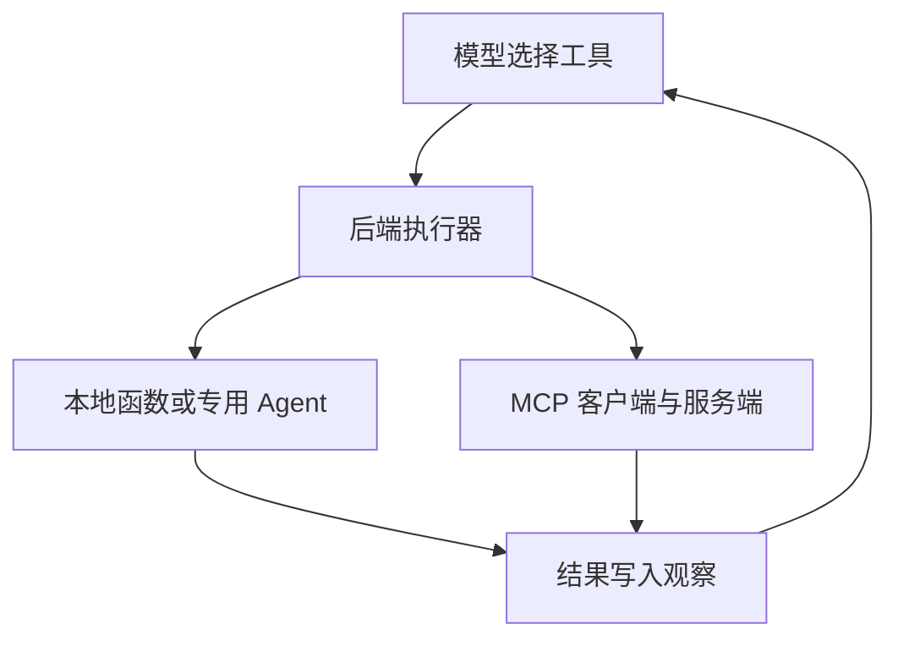

### MCP 如何使用：
用户消息输入后，后端先准备一个 context，context 会经过包装，选择和提示词组装。然后 MCP被包装成普通工具，**放入工具箱**，备用

### MCP的外部能力连接规范

MCP 使用到的项目中的四个角色

| 角色         | 项目里对应什么               | 职责               |
| ---------- | --------------------- | ---------------- |
| Host       | DevFlow 后端及 ChatAgent | 管理模型、工具和上下文      |
| MCP Client | `StdioMcpClient`      | 启动服务、发送协议请求、接收响应 |
| MCP Server | `memory_server.py`    | 声明工具、解析请求、分发调用   |
| 业务实现       | `MemoryTools`         | 查询历史证据、聊天原文、封存会话 |

规范一：双方通过什么通道通信？——项目使用 stdio

简单理解 stdio 传输就是输入输出管道的对话

过程示例：

模型提出：调用 devflow_search_evidence，查询历史决策
    ↓
ChatAgent 执行对应的 Python 工具
    ↓
MCP Client 把调用转换成 JSON-RPC 消息
    ↓
MCP Server 接收消息，执行记忆查询
    ↓
查询结果沿原路返回
    ↓
ChatAgent 把结果放进上下文，模型据此回答

#### MCP的外部能力连接规范？
面试时可以这样回答：
> 我们把记忆查询能力封装成独立的 MCP Server，后端通过 StdioMcpClient 启动并连接它。双方使用 JSON-RPC 消息，完成初始化后通过 tools/call 调用工具。Server 声明工具名称、用途和输入 Schema，再把请求分发到 MemoryTools 执行。ChatAgent 使用 LangChain Tool Calling 选择工具，后端包装函数负责调用 MCP，并把结果转成模型可读取的观察信息。当前采用手工工具注册，仓库和会话范围由后端注入，避免依赖模型决定数据访问范围。

skill 如何使用：
skill 会被拆成两个部分：顶部的配置和文件下面的正文
配置内容：名字，入口以及对应的实用工具
agent 会根据本轮消息自动选择 skill（可以**指定**或者**自动匹配**）

MCP和skill 的工作流程：
1. 函数封装成 tool 
2. skill 通过提示词提供给模型，提示词会加入已注册的 DevFlow 技能，按需加载 skill 指令，总结服务端上下文，返回最终结果
3. 模型提出调用请求，最后 chatagent真正执行 MCP

Skill 指令由运行时按需加载并加入提示词；工具返回后，结果摘要进入 observations，再参与后续判断。这里既有本地调用，也有 MCP 调用。

