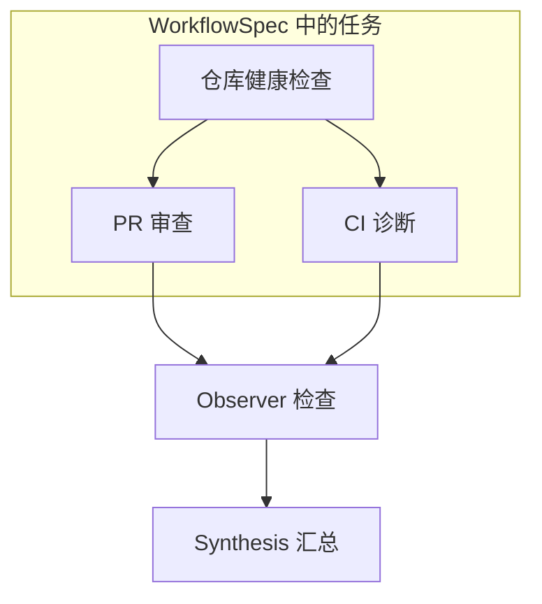

# 多 Agent 工程工作流怎么调度（精简版）

当用户问“PR #86 能不能合并”时，需要综合代码审查、CI 状态等证据。项目通过 **WorkflowOrchestrator（工作流协调器）集中调度**，统一收集结果、检查冲突，再生成建议。

## 1. 谁规划，谁执行

```text
ChatAgent 调用 workflow.run_engineering_review
    ↓
PlannerAgent 生成 WorkflowSpec（工作流计划）
    ↓
WorkflowOrchestrator 按依赖调度专项任务
    ↓
ObserverAgent 检查失败、证据缺口和结论冲突
    ├─ 满足补规划条件且未达上限 → Planner 补计划 → 再执行、再检查
    └─ 结束检查 → SynthesisAgent 汇总最终建议
```

Planner 当前根据用户消息与可用数据，使用预设条件规则选择任务。`WorkflowSpec` 保存目标、任务、依赖、验收标准、最大并发数和人工确认要求；每个任务还声明目标对象与数据来源范围。

源码：[工具入口](../backend/app/api/routes/chat.py#L1286)、[PlannerAgent.run](../backend/app/services/agents/planner_agent.py#L9)、[WorkflowSpec](../backend/app/schemas/workflow.py#L37)。

## 2. 依赖与并发怎么控制

任务通过 DAG（有向无环图）声明先后依赖。以当前有 PR 和 CI 数据为例，任务依赖与后续汇总流程如下：



调度器维护待执行任务和成功结果：

1. 只有**所有依赖都成功**的任务，才进入就绪列表。
2. 从就绪列表取最多 `max_parallel_tasks` 个任务，用 `asyncio.gather()` 并发执行，默认上限为 **3**。
3. 等这一批全部返回后，更新状态，再找下一批可执行任务。

因此，PR 审查和 CI 诊断可以并行；当前实现按批次等待，批内较慢的任务会影响下一批启动时间。

源码：[WorkflowOrchestrator._run_task_graph](../backend/app/services/agents/workflow_orchestrator.py#L20)。

## 3. Agent 之间怎样交接数据

协调器根据 `task_type` 找到注册的任务执行函数，执行函数准备材料并调用专项 Agent。结果统一封装为 `WorkflowTaskResult`，包含状态、摘要、业务输出、证据数量、置信度和引用，交给 Observer 与 Synthesis 使用。

**依赖主要控制执行顺序。** 当前调度器不会把上游结果自动注入下游输入；下游材料由任务执行函数准备。

源码：[任务执行与结果校验](../backend/app/services/agents/workflow_orchestrator.py#L221)、[WorkflowTaskResult](../backend/app/schemas/workflow.py#L48)。

## 4. 失败和冲突怎么处理

- **执行异常或超时**：记录为 `error`；未注册执行函数则记为 `skipped`。依赖这些任务的下游也会跳过，其他就绪任务仍可继续。
- **循环或缺失依赖**：剩余任务无法就绪时，记录依赖错误并结束本轮调度。
- **结论冲突**：Observer 按规则检查。例如 PR 建议合并、CI 判断阻塞合并时，标记冲突与阻塞项，Synthesis 给出暂缓合并的建议。

Observer 还检查证据缺失、低置信度和人工确认事项。它执行的是预设规则检查，不能据此保证业务结论一定正确。

源码：[ObserverAgent.run](../backend/app/services/agents/observer_agent.py#L9)、[合并冲突检查](../backend/app/services/agents/observer_agent.py#L97)。

## 5. 什么时候补规划，什么时候停止

任务失败、证据缺口或低置信度等情况可以触发重规划。Planner 当前主要补充 RAG 检索、安全检查或 CI 诊断；已经成功的任务会复用。

默认最多补规划 **1 次**，允许配置的最大值为 **2 次**。没有可触发重规划的问题、达到上限，或新旧任务图相同，就停止循环并汇总报告。**结束后仍可能存在阻塞项或缺失证据。**

当前补检索也不会自动把新证据送回已成功的专项 Agent 重新分析，这部分仍有改进空间。

源码：[执行与重规划循环](../backend/app/services/agents/workflow_orchestrator.py#L41)、[重规划上限与触发条件](../backend/app/services/agents/workflow_orchestrator.py#L297)、[PlannerAgent.replan](../backend/app/services/agents/planner_agent.py#L9)。

## 面试口述版

> 项目采用中心化调度。ChatAgent 调用工程工作流工具，Planner 按规则生成包含任务和依赖的计划，Orchestrator 找出依赖已成功的任务，按并发上限分批运行。各任务返回统一的结构化结果，Observer 检查失败、证据缺口和跨 Agent 冲突，必要时触发有限次数的补规划，最后由 Synthesis 汇总建议。异常、超时和下游跳过都会保留在结果中。当前实现的边界是规则驱动、按批次等待，以及补检索后尚未自动形成专项分析的反馈闭环。

这里的任务调度由 `WorkflowOrchestrator` 自己实现；ChatAgent 的 LangGraph 图负责对话与工具调用，两者是不同层次的编排。
